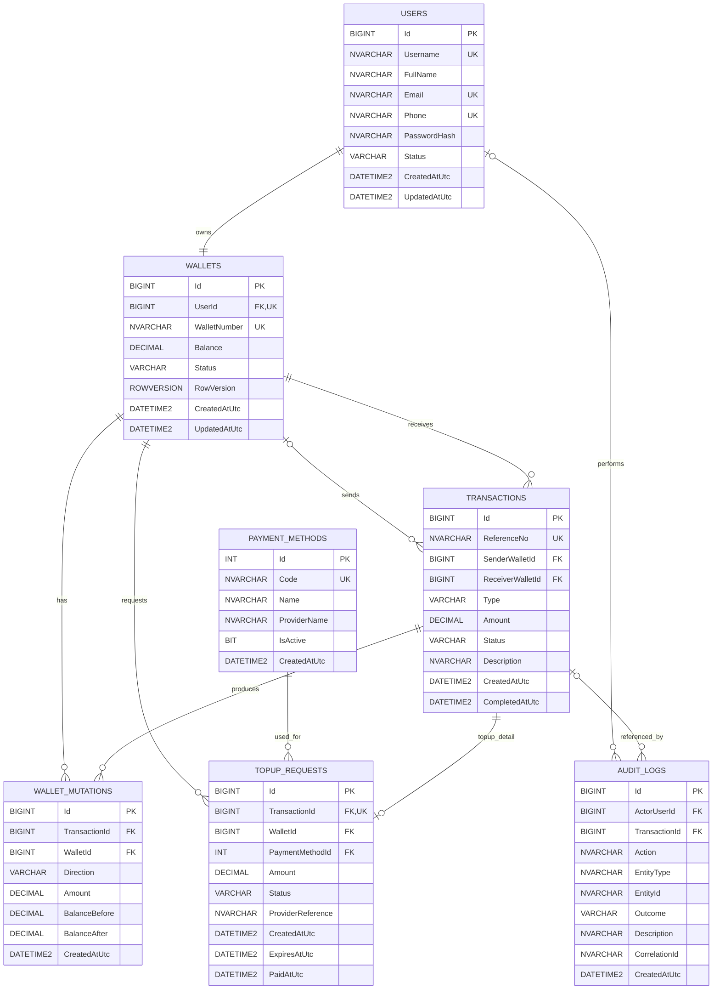

# E-Wallet Application

Aplikasi E-Wallet berbasis ASP.NET Core Web API dengan fitur pengelolaan pengguna, wallet, top up, transfer saldo, wallet mutasi, dan auditlog.

Aplikasi ini menggunakan Entity Framework Core sebagai ORM untuk mengelola komunikasi antara aplikasi dan SQL Server.

## 1. Fitur Aplikasi

### User Management
- Menampilkan daftar pengguna.
- Menampilkan detail pengguna.
- Menambahkan pengguna beserta wallet.
- Mengubah data pengguna.

### Wallet Management
- Menampilkan informasi wallet.
- Melihat saldo wallet.
- Mengambil detail wallet berdasarkan ID.

### Top Up Request
- Membuat permintaan top up.
- Memilih metode pembayaran.
- Mengelola status permintaan top up.
- Menambahkan saldo setelah top up dikonfirmasi.
- Mencatat perubahan saldo ke WalletMutations.

### Transfer
- Transfer saldo antar-wallet.
- Validasi wallet pengirim dan penerima.
- Validasi kecukupan saldo.
- Mengurangi saldo pengirim.
- Menambahkan saldo penerima.
- Mencatat transaksi dan mutasi saldo.
- Menjaga konsistensi data menggunakan database transaction.

### Transaction & Reporting
- Melihat riwayat transaksi.
- Melihat histori mutasi wallet.
- Menghitung total pemasukan dan pengeluaran.
- Mendukung pagination.

### Audit & Reliability
- Mencatat aktivitas melalui AuditLogs.
- Menangani kegagalan operasi dengan rollback.
- Mencegah lost update menggunakan RowVersion.

## 2. Entity Relationship Diagram (ERD)

Database menggunakan tujuh entitas utama untuk mengelola pengguna, wallet, transaksi, mutasi, metode pembayaran, permintaan top up, dan audit aktivitas.




### Penjelasan Relasi

- **Users - Wallets:** Setiap pengguna memiliki wallet.
- **Wallets - Transactions:** Wallet dapat menjadi pengirim maupun penerima transaksi.
- **Wallets - WalletMutations:** Setiap wallet memiliki histori perubahan saldo.
- **Transactions - WalletMutations:** Transaksi menghasilkan catatan mutasi saldo.
- **Wallets - TopUpRequests:** Wallet dapat memiliki beberapa permintaan top up.
- **PaymentMethods - TopUpRequests:** Metode pembayaran digunakan dalam permintaan top up.
- **Users - AuditLogs:** Aktivitas pengguna dicatat dalam audit logs.

## 3. Database Migration

Project menggunakan Entity Framework Core Migration untuk mengelola perubahan struktur database.

```bash
dotnet add package Microsoft.EntityFrameworkCore.SqlServer
dotnet add package Microsoft.EntityFrameworkCore.Design
```

### Membuat Migration

Masuk ke folder project API:

```bash
cd Ewallet.Api
```

Buat migration pertama:

```bash
dotnet ef migrations add InitialCreate
```

Untuk perubahan struktur database berikutnya:

```bash
dotnet ef migrations add AddWalletMutations
```


### Menjalankan Migration

Terapkan migration ke SQL Server:

```bash
dotnet ef database update
```

### Melihat Daftar Migration

```bash
dotnet ef migrations list
```

## 4. Database Seeding

Database seeding digunakan untuk memasukkan data awal agar aplikasi dapat langsung diuji tanpa harus memasukkan seluruh data secara manual.

Seeding dapat digunakan untuk:
- Data pengguna awal.
- Data wallet awal.
- Data metode pembayaran.


```csharp
builder.Services.AddDbContext<AppDbContext>(options =>
{
    options.UseSqlServer(connectionString)
        .UseSeeding((context, _) =>
        {
            PaymentMethodSeedData.Seed(context);
            UserSeedData.Seed(context);
        })
        .UseAsyncSeeding(async (context, _, ct) =>
        {
            await PaymentMethodSeedData.SeedAsync(context, ct);
            await UserSeedData.SeedAsync(context,ct);
        });
});
```


## 5. Konfigurasi Database

Atur connection string pada program.cs.

```json
var connectionString = builder.Configuration.GetConnectionString("EwalletWeekly6") ?? throw new InvalidOperationException("connection belum diconfigurasi");
```

Contoh konfigurasi DbContext:

```csharp
builder.Services.AddDbContext<AppDbContext>(options =>
{
    options.UseSqlServer(connectionString)
```
